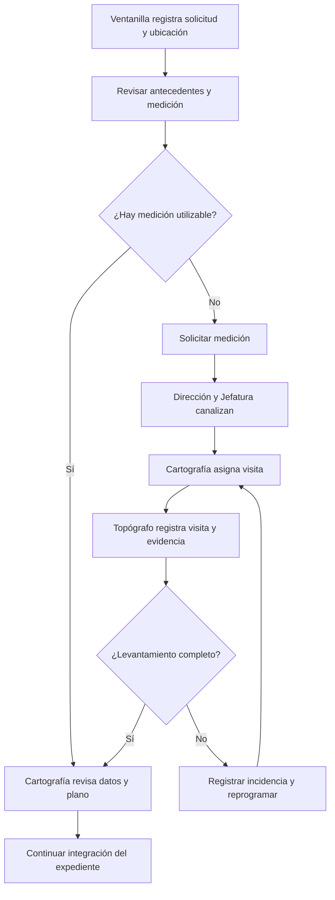

# SIGEP: primera titulación desde Ventanilla

Revisión: 25 de noviembre de 2026. Prioridad confirmada por Eduardo: una persona solicita un título para su terreno, Ventanilla registra la solicitud y las áreas completan el expediente hasta la entrega. Este es el caso principal para el siguiente desarrollo.

Este documento concilia las fuentes locales y propone su traducción a pantallas y datos. No modifica el Word/PPTX originales, no acredita aprobación institucional del procedimiento y no representa una funcionalidad ya implementada.

**Actualización de implementación:** después de esta planeación se agregó el primer incremento de recepción sin predio, canalización, asignación y visita inicial. Su alcance comprobado, migración pendiente y guía de prueba están en [Recepción inicial](recepcion-inicial.md). Los diagnósticos de carencias que siguen describen la revisión anterior a ese incremento; el flujo completo hasta entrega continúa siendo una propuesta.

## 1. Fuentes locales revisadas

- `C:\Proyectos\SIGEP\archivos_sigep\SGFL_Documento_Requerimientos_v1.0.docx`: versión del 20/08/2026; secciones 5 y 6, RF-006 a RF-040, reglas RN y criterios de aceptación. El propio documento se identifica como propuesta para validación.
- `C:\Proyectos\SIGEP\archivos_sigep\PROCESOS DE FUNDOS LEGALES.pptx`: diapositiva 1, titulación detallada en 27 etapas; diapositiva 2, búsqueda de información y expedición de documentos. Se revisaron textos y su posición respecto a números de etapa y áreas.
- Implementación: alta de expediente en `api/server.mjs`, formularios de expediente/medición/documentación, `api/permissions.mjs` y `sql/create_mediciones_expediente.sql`.

El Word resume el circuito de titulación en TIT-01 a TIT-17. Las 27 etapas de la presentación no equivalen a 27 pantallas; varias acciones ocurren sobre la misma ficha de expediente.

## 2. Caso que debe resolver el producto

Una persona llega a Ventanilla porque quiere obtener el primer título de un terreno que identifica por ubicación y referencias. Puede desconocer clave catastral, superficie y coordenadas. El personal registra sus datos, lo presentado y lo pendiente, obtiene un folio y canaliza el trámite. Si no hay levantamiento utilizable, se tramita la medición. El topógrafo entra al mismo sistema interno, ve su orden asignada y registra el resultado de la visita. Cartografía revisa el resultado y completa el dato territorial.

La identidad del expediente se conserva durante todo el proceso. Registrar una atención inicial y admitir formalmente un trámite son hechos distintos: deben tener estado y fecha propios, sin recapturar a la persona ni perder la historia. En este alcance el ciudadano es solicitante; las cuentas del portal pertenecen al personal que lo atiende.

El mapa sirve para localizar y validar el terreno durante el proceso. La recepción no debe depender de que ya exista un polígono. Tampoco se debe llamar propietario acreditado a quien únicamente ha presentado una solicitud.

## 3. Correspondencia entre documentos y acciones del sistema

La agrupación siguiente es una interpretación funcional documentada. Se conservan las tareas expresas de la presentación aunque el Word las agrupe.

| Word | Detalle de la presentación | Acción/pantalla que necesita SIGEP |
|---|---|---|
| TIT-01 | Inicio y verificación de situación del lote, primeras etapas. | Ventanilla crea expediente, captura solicitante y ubicación referida y busca antecedentes. |
| TIT-02 | Medido/no medido y solicitud de medición, primeras etapas. | Registrar condición y fundamento; generar solicitud cuando corresponda. No deducir que está medido únicamente porque aparece en el mapa. |
| TIT-03 | Etapas 5–7: Dirección canaliza a Fundos, Jefatura canaliza a Cartografía, Cartografía asigna campo. | Bandejas y acciones de canalización; después asignación a un topógrafo con fecha compromiso. |
| TIT-04 | Etapa 8: Topógrafo levanta y mide. | Registrar visita, medidas/coordenadas, observaciones y evidencia; devolver a Cartografía. |
| TIT-05 | Etapa 9: actualización cartográfica y plano. | Cartografía valida el levantamiento, crea/vincula el predio y conserva la versión del plano. |
| TIT-06 | Etapas 10–11: requisitos y orden/conceptos de pago en Ventanilla. | Checklist aplicable y emisión/registro de orden de pago. Los documentos futuros no se exigen para abrir la atención. |
| TIT-07 | Etapas 12–13: pago y presentación de recibos. | Caja registra pago; Ventanilla recibe/vincula comprobantes. Emitir una orden y cobrar son permisos distintos. |
| TIT-08 | Etapas 14–15: Digitalización y Captura. | Digitalización incorpora archivos; Captura revisa/transcribe propietarios y valores. |
| TIT-09 | Etapas 16–17: Titulación compara expediente y BD; Informática compara BD y cartografía e imprime título/plano. | Dos revisiones separadas y trazables. Preparación/generación bajo el flujo de Titulación y apoyo de impresión/consistencia de Informática. |
| TIT-10 | Primera parte de etapa 18: Titulación verifica título impreso contra expediente. | Revisar una versión concreta del título antes de enviarlo. |
| TIT-11 | Resto de etapa 18: Jefatura elabora oficio, Dirección firma oficio, Jefatura remite. | Preparar, autorizar y registrar envío a Consejería, con folio y acuse. |
| TIT-12 | Etapa 19: Consejería recibe/revisa, recaba firmas y devuelve. | Registrar hitos y documentos recibidos. No convertir automáticamente a Consejería en un usuario local. |
| TIT-13 | Etapa 20: Titulación recibe, prepara copias; Dirección firma/sella copias y Jefatura envía al RPP. | Registrar retorno, certificación y paquete enviado al RPP. |
| TIT-14 | Etapas 21–22: inscripción y recuperación del expediente por Titulación. | Datos de inscripción, fechas, devoluciones y título inscrito. |
| TIT-15 | Etapa 23: Cartografía genera cédula y valores. | Generar/registrar cédula final. Distinguirla de los valores capturados antes. |
| TIT-16 | Etapa 24: Digitalización incorpora título inscrito e imprime cédula. | Archivar versión final del título y cédula. |
| TIT-17 | Etapas 25–27: Afectación, preparación por Titulación, ceremonia/entrega y archivo. | Actualización final, comprobante de recepción, receptor, fecha y archivo del expediente. |

### Diferencias que no se deben esconder

1. **Canalización inicial:** el PPTX incluye Dirección y Jefatura antes de Cartografía. El Word agrupa esa parte. La implementación debe conservar esos pases como tareas, salvo que la dependencia apruebe simplificarlos.
2. **Impresión:** el PPTX ubica impresión de título/plano en Informática; el Word también atribuye impresión/generación a Titulación. Propuesta: Titulación responde por el contenido y revisión del expediente; Informática valida consistencia y produce/imprime la versión destinada a revisión de Titulación. Confirmar quién puede emitir cada versión y qué revisión precede a su impresión final.
3. **Valores y cédula:** hay captura/revisión de valores antes del título y generación de cédula después del RPP. Son dos momentos documentados; definir si existe cédula preliminar además de la final. No exigir que ya exista cédula final para recibir la solicitud.
4. **Afectación:** aparece como área/actividad en el PPTX, pero no figura como uno de los 13 roles del Word. TIT-17 atribuye el cierre a Titulación/Ventanilla. Conservar una tarea de afectación final y confirmar quién la ejecuta; no inventar una cuenta ni conceder este permiso a Informática por suposición.
5. **Legal:** ambos documentos contemplan apoyo jurídico durante titulación. El botón de dictamen actual pertenece a certificaciones/constancias. Añadir participación jurídica trazable para titulación, sin reutilizar ese dictamen como aprobación automática de un título.

## 4. Primera parte del flujo, con sus ramas

La rama de incidencia/reprogramación es una propuesta de producto para no marcar una visita fallida como medición completa. Las canalizaciones deben guardar actor, fecha, motivo y área destino.

## 5. Pantallas y datos por momento

| Pantalla / acción principal | Datos que se capturan | Datos que se completan después |
|---|---|---|
| Ventanilla: Nueva solicitud de título | Nombres, primer apellido, segundo apellido cuando exista, identificación presentada, contacto disponible, domicilio de notificación, representación si aplica, municipio/localidad y referencias del terreno; programa/jornada si existe. | Clave oficial, coordenadas, superficie validada, título, inscripción y cédula final. |
| Ventanilla: Documentos presentados | Tipo de documento, archivo si se recibió, fecha, recibido/pendiente y observaciones. | Validación por responsable y requisitos de etapas posteriores. |
| Dirección/Jefatura: Revisar y canalizar | Expediente, observaciones, área destino y devolución cuando aplique. | Levantamiento/plano, si todavía no existen. |
| Cartografía: Asignar medición | Solicitud, ubicación, topógrafo, instrucciones y compromiso. | Datos de la visita. |
| Topografía: Mis visitas | Fecha real, resultado, medidas/coordenadas, sistema de referencia y método, incidencias, fotografías/archivos. | Aprobación cartográfica y asignación de clave oficial. |
| Cartografía: Validar levantamiento | Geometría, plano, área calculada, medida y validada, diferencias y motivo; clave si ya se asignó. | Cédula final en el momento documentado. |
| Expediente: Integración, pago y captura | Checklist, recibos, personas interesadas y valores transcritos con fuente. | Revisiones de Titulación/Informática. |
| Titulación/Informática: Revisiones y documentos | Resultado por versión, observaciones, correcciones y título/plano preparado. | Firmas e inscripción externa. |
| Titulación/Jefatura/Dirección: Envíos | Oficio, destinatario, paquete documental, autorización, fecha, acuse y retorno. | Datos que entregue Consejería/RPP. |
| Entrega y archivo | Título inscrito, plano, cédula, afectación final, receptor, carácter, fecha y acuse. | Cierre únicamente con controles resueltos. |

La captura debe usar etiquetas visibles y ejemplos. Segundo apellido y datos desconocidos no se rellenan con valores ficticios. La obligatoriedad exacta para admisión formal procede del catálogo validado; abrir una atención no implica que el expediente ya esté integrado.

RF-014 enumera solicitud de predio, constancia de posesión, identificación, acta de nacimiento y comprobante de domicilio. La ficha pública de Durango agrega CURP y pagos en su listado; confirmar su correspondencia y etapa antes de convertir todo en requisito de la primera pantalla.

## 6. Ajustes concretos a los roles

Se mantienen los 13 roles del documento. La propuesta requiere permisos por acción y estado, validados también en API.

- Ventanilla: crear solicitud sin predio, registrar faltantes, solicitar medición, recibir comprobantes y registrar entrega conforme al flujo.
- Dirección: canalización inicial, autorización/firma de oficio y certificación de copias según la presentación.
- Jefatura: canalizar a Cartografía, preparar oficios y coordinar envíos; revisión y devolución con motivo.
- Cartografía: asignar órdenes, aceptar/devolver levantamiento, modificar geometría, validar plano y valores, generar/registrar cédula.
- Topografía: leer y completar sus órdenes asignadas; registrar incidencias y evidencias. Una visita registrada pasa a revisión, no se convierte sola en título autorizado.
- Digitalización: archivos, clasificación, legibilidad y versiones; diferenciar esta revisión de la aprobación del contenido jurídico/técnico.
- Captura: datos personales, propietarios y valores tomados de documentación; no adjudicarle validación técnica por poder escribir.
- Caja: conceptos, pagos y evidencia; Ventanilla no adquiere permiso de cobro por recibir un recibo.
- Titulación: revisión documental, revisión del título, gestión de etapas externas y preparación de entrega.
- Informática: acceso a los datos necesarios para comparar expediente y cartografía, revisión de consistencia y apoyo de generación/impresión conforme al punto 3. No es un administrador de usuarios por defecto.
- Legal: consultas/observaciones jurídicas vinculadas a la etapa, con respuesta y responsable; su proceso de certificaciones/constancias se conserva separado.
- Administración: cuentas, catálogos, requisitos y configuración; no suplir automáticamente una firma institucional.
- Consulta/Auditoría: acceso de lectura autorizado a resultados, movimientos e indicadores.

## 7. Cambio de datos necesario

La API actual exige entre uno y veinte `predio_ids` existentes. El formulario de alta parte de una entidad del mapa. Además, `mediciones_expediente` usa la combinación expediente/predio como clave primaria y referencia obligatoria. Esas tres dependencias impiden el caso sin predio previo.

Diseño recomendado para la siguiente implementación:

1. Conservar un expediente identificable desde la recepción, con estado inicial y datos del solicitante. Separar en sus campos la atención inicial de la admisión/integración formal.
2. Guardar una localización preliminar propia del expediente: municipio, localidad, referencias y punto aproximado opcional. No crear un polígono inventado ni usar cero como superficie desconocida.
3. Registrar la orden de medición con identificador propio y relación al expediente/localización; puede existir sin predio definitivo. Preservar visitas y reasignaciones anteriores.
4. Cartografía vincula un predio existente o crea el registro técnico tras revisar el levantamiento. Los documentos y mediciones siguen asociados al mismo expediente.
5. Añadir nombres y apellidos separados mediante migración compatible. Conservar el nombre original; no dividir automáticamente por espacios los registros históricos.
6. Usar tareas/movimientos para canalizaciones y revisiones; bloquear transiciones desde el servidor cuando falten condiciones. El título, plano y sus revisiones deben identificar versión.

Son decisiones de diseño, no SQL ejecutado. Antes de migrar se compara el esquema del ambiente destino con los scripts del repositorio.

## 8. Comparación con otros estados

Consulta realizada el 25/11/2026. Las fuentes son oficiales y se usan como referencias de diseño; sus reglas, costos, vías legales y requisitos no se trasladan automáticamente a Durango.

| Referencia | Qué documenta | Aplicación propuesta en SIGEP |
|---|---|---|
| Estado de México, IMEVIS, lineamientos publicados el 23/09/2025, apartado 9.1. | Recepción de solicitud, revisión documental/antecedentes, verificación de campo, gestiones externas, inscripción y entrega. | Separar recepción, validación, trabajo de campo y cierre; guardar el resultado de cada paso. |
| Veracruz, INVIVIENDA, formatos de regularización y levantamiento 2026. | Solicitud de regularización distinta de la solicitud topográfica; esta última pide localización/contacto y contempla agenda, georreferenciación, medidas y plano. | Orden de campo vinculada al caso y ubicación referida; el ciudadano aporta cómo localizarlo y el área técnica produce el levantamiento. |
| Veracruz, solicitud de escrituración para programas sociales. | Gestión documental y envío a notaría, seguido de inscripción y entrega por el instituto. | Registrar paquetes, versiones y retorno; esa vía notarial no sustituye la ruta Consejería/RPP de los documentos de SIGEP. |
| Chihuahua, Departamento de Regularización del Suelo Urbano. | Atención y titulación en colonias del Gobierno del Estado o administradas por su Secretaría. | Registrar ámbito/programa y revisión de competencia; no suponer que cualquier terreno pertenece a la misma ruta. |

Fuentes abiertas y leídas:

- [IMEVIS: lineamientos, apartado 9.1, página impresa 29](https://legislacion.edomex.gob.mx/sites/legislacion.edomex.gob.mx/files/files/pdf/gct/2025/septiembre/sep231/sep231b.pdf). Referencia publicada en 2025; no se afirma que sea una revisión exhaustiva de reformas posteriores.
- [INVIVIENDA: catálogo de trámites y formatos](https://invivienda.gob.mx/index.php/tramites-y-servicios/).
- [INVIVIENDA: solicitud de regularización 2026](https://invivienda.gob.mx/Portals/0/2026/Formatos_GRCSBI/Asignaci%C3%B3n%20y%20regularizaci%C3%B3n/FORMATO%201B%20SOLICITUD%20DE%20REGULARIZACION_2026.pdf).
- [INVIVIENDA: solicitud de levantamiento topográfico 2026](https://invivienda.gob.mx/Portals/0/2026/Formatos_GRCSBI/Servicios/SOLICITUD%20DE%20LEVANTAMIENTO%20TOPOGRAFICO_2026%20.pdf).
- [INVIVIENDA: escrituración para programas sociales](https://invivienda.gob.mx/Portals/0/2025/Tramites%20y%20Servicios/GERENCIA%20JURIDICA/Solicitud%20para%20escrituraci%C3%B3n%20para%20progamas%20sociales.pdf).
- [Chihuahua: Regularización del Suelo Urbano](https://chihuahua.gob.mx/sedue/DRSU).

Referencia local adicional: [Durango: título de propiedad en fundo legal](https://www.durango.gob.mx/tramites-y-servicios/secretaria_de_educacion/secretaria_de_finanzas__y_de_administracion/expedicion_de_titulo_de_propiedad_del_lote_dentro_del_fundo_legal). Se recuperó el contenido indexado de la ficha oficial; la apertura directa devolvió 502. Describe recepción en Ventanilla, integración y pagos después de integrar el expediente. No se fijan tarifas ni plazos del sistema usando esa ficha.

## 9. Primer incremento funcional y prueba de aceptación

El siguiente incremento debe demostrar el caso completo hasta el regreso de campo, incorporando lo existente:

1. Ventanilla registra a una persona con nombres separados, ubicación referida y documentos disponibles; guarda con folio sin clave, geometría ni `predio_id` obligatorio.
2. Busca antecedentes y registra la condición de medición; si no tiene levantamiento utilizable, crea la solicitud de medición vinculada al expediente.
3. Dirección/Jefatura reciben la tarea y canalizan; Cartografía asigna topógrafo y compromiso.
4. Solo el topógrafo asignado puede registrar el resultado de su visita y anexar evidencia. Una incidencia permite reprogramación sin borrar la visita anterior.
5. Cartografía revisa y acepta/devuelve; cuando acepta, vincula/completa el predio y plano. Ventanilla consulta el resultado en el mismo expediente.
6. El historial identifica cada actor, transición y fecha. Ninguna de estas acciones marca todavía el título como emitido o inscrito.

Pruebas adicionales del mismo incremento: lote ya medido que no requiere nueva visita; usuario no asignado intentando modificar una orden; solicitud con documentos incompletos; devolución de Cartografía; coincidencia con predio ya existente sin duplicarlo.

Después se conectan integración/pagos/captura, revisiones de Titulación e Informática, firmas/RPP y entrega. La falta de plantilla final no bloquea recepción, canalización ni medición. Manual, intranet y QGIS siguen fuera de esta iteración por indicación del usuario.

## 10. Estado de esta revisión

Se revisaron las fuentes locales y se documentó la comparación externa. Se actualizaron las prioridades y responsabilidades en los documentos de planeación del repositorio. No se modificó código de aplicación, no se migró la base y no se desplegó un flujo nuevo en esta revisión.
