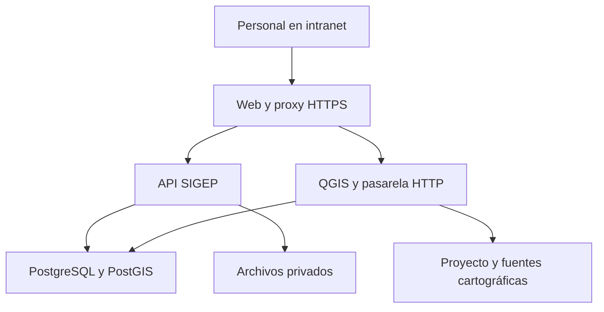

# SIGEP — Manual de instalación con Docker

Versión 0.4 · 27/11/2026. Para personal técnico encargado de instalar y operar SIGEP en la intranet institucional.

**Estado:** arquitectura y procedimiento definidos; instalación limpia pendiente de ensayo. Aún faltan el Compose conjunto, el esquema base validado y el proyecto QGIS con sus fuentes. Los comandos que usan Compose aplican cuando estos archivos formen parte de una entrega liberada; todavía no hay un `compose.yaml` completo en este repositorio.

Avance del 27/11: ya se descargó y verificó la extracción del servidor. Existe una [base SQL candidata](../deploy/database/README.md) con 24 tablas, catálogo y permisos; aún no se ejecutó en PostgreSQL real. Ver [Revisión de extracción](revision-extraccion-2026-11-27.md).

Antes de instalar, completar [Preparar el paquete instalable](preparar-entrega.md). Los ejemplos anteriores del HomeLab se conservan en [Referencia de operación técnica](operacion-tecnica-referencia.md). Este manual describe el destino institucional; sus usuarios entrarán por navegador, sin ejecutar npm ni mantener túneles individuales.

## 1. Arquitectura obligatoria de esta entrega

SIGEP se prepara como **servicios separados en contenedores Docker**, administrados con Docker Compose. Pueden compartir un servidor Linux. PostgreSQL y la extensión PostGIS pertenecen al mismo servicio de base de datos.

| Servicio previsto | Función | Persistencia | Acceso |
|---|---|---|---|
| `db` | PostgreSQL/PostGIS: cuentas, expedientes, catálogos y geometrías. | Volumen exclusivo de BD. | Red de servicios; sin 5432 abierto a todas las PCs. |
| `api` | Autenticación, permisos, trámite y archivos. | Volumen privado en `/data/private`. | Desde el proxy; puerto interno 8100. |
| `qgis` | Publicar el proyecto y fondos como WMS. | Proyecto, estilos y fuentes. | Desde el proxy/pasarela HTTP. |
| `web` | Frontend compilado y proxy HTTPS. | Configuración y material TLS administrado. | URL institucional para las PCs. |

Si la imagen QGIS usa FastCGI, requiere una pasarela HTTP dentro de la imagen preparada o en otro servicio. Sus puertos/directivas se fijarán al recuperar la configuración real; no asumir que cualquier contenedor QGIS acepta HTTP directamente.



La conexión QGIS–BD se utiliza si hay capas PostGIS. Las PCs operadoras necesitan navegador y acceso a la red institucional; QGIS Desktop sólo lo necesita quien prepara la cartografía. Intranet significa red privada, no otro tipo de contenedor.

## 2. Confirmar infraestructura con Informática

Registrar host/VM, arquitectura, sistema operativo, Docker/Compose admitidos, DNS interno, TLS, reglas de red, responsables y acceso de administración. Definir espacio y crecimiento para BD, archivos, cartografía y respaldos; usuarios concurrentes, salida a Internet y objetivos de recuperación.

No hay todavía un mínimo medido de RAM/CPU para producción. Un host único tiene un punto único de fallo; alta disponibilidad exige otro diseño y ensayo. Docker por sí solo no acredita cumplimiento institucional.

## 3. Verificar el paquete de entrega

| Material | Condición para continuar |
|---|---|
| Versión y checksums | Commit, versión de esquema, imágenes/digests y arquitectura identificados. |
| `compose.yaml` y configuración | Servicios, redes, volúmenes, salud, reinicio y variables documentados. |
| Web/API | Misma versión, imágenes o compilado/fuentes con lockfiles. |
| SQL base, catálogos y permisos | Probados en una BD vacía, con orden de ejecución. |
| Migraciones | Sólo cambios posteriores al esquema base, con registro de aplicación. |
| Proyecto QGIS y recursos | Rutas, conexiones, derechos de uso y renderizado comprobados. |
| Proxy/TLS y manuales | Acceso probado desde otra PC y evidencia de aceptación/recuperación. |

**Si falta un componente, completar la preparación antes de instalar.** El repositorio actual tiene código y migraciones, pero no acredita todavía una instalación nueva completa. No incluir datos ciudadanos, cuentas de ejemplo, entornos privados ni `reset_demo_users.sql` como inicialización institucional.

## 4. Preparar Docker e imágenes

Instalar Docker Engine y Compose mediante el procedimiento admitido para el sistema operativo. En Linux comprobar:

```bash
docker version
docker compose version
docker info --format '{{.OSType}} {{.Architecture}}'
```

Usar imágenes versionadas y de arquitectura compatible. No cambiar la versión mayor de PostgreSQL reutilizando su volumen. La ruta de datos debe corresponder a la imagen elegida.

Con Internet, obtener las imágenes aprobadas. Sin Internet, verificar y cargar el archivo de imágenes preparado para la entrega con `docker load -i imagenes-sigep.tar`. Ese archivo no lo genera el extractor de SQL/QGIS. Si se construye la API desde fuentes, usar `docker build -t sigep-api:VERSION ./api`; no copiar `node_modules` de Windows dentro de Linux.

## 5. Configurar el destino

Crear archivos privados a partir de plantillas sin secretos. Las credenciales se generan para el destino y se custodian fuera de Git.

| Variable | Configuración |
|---|---|
| `DB_HOST` | Nombre del servicio Compose, previsto `db`. |
| `DB_PORT` / `DB_NAME` | 5432 interno / `sigep`, salvo adaptación documentada. Los SQL actuales mencionan `sigep`. |
| `DB_USER` / `DB_PASSWORD` | Cuenta limitada `sigep_editor` y contraseña nueva. |
| `SIGEP_ADMIN_KEY` | Clave privada de recuperación, mínimo 32 caracteres. |
| `PORT` | 8100 dentro de API. |
| `SIGEP_PRIVATE_STORAGE_DIR` | `/data/private`, volumen escribible por el usuario `node`. |
| `SIGEP_SECURE_COOKIE` | `1` para HTTPS institucional. |
| `VITE_QGIS_WMS_URL` | Endpoint WMS accesible desde las PCs, preferentemente mediante el proxy del sitio. |
| `VITE_QGIS_MAP` | Ruta del proyecto dentro del contenedor QGIS. |
| `VITE_DESPACHO_NOMBRE` | Nombre institucional mostrado por la web. |

Las variables `VITE_` se incorporan al navegador al compilar; no contienen claves. Cambiarlas exige reconstruir la web. Los nombres HomeLab (`sigep-postgis`, `qgis-server_default`) son referencias del origen, no valores universales.

Cuando exista el Compose completo, ejecutar `docker compose config --quiet` desde su carpeta. Evitar compartir la salida completa de `docker compose config`: puede contener secretos resueltos.

## 6. Crear la base de datos

Una instalación nueva usa esquema, catálogos aprobados y roles/permisos nuevos. Un traslado usa respaldo de BD y documentos correspondientes a la misma ventana; requiere su procedimiento de recuperación.

Orden previsto para la instalación nueva: roles → extensiones/esquema → catálogos → permisos. El archivo extraído `01-esquema-origen.sql` debe revisarse y conciliarse con el código antes de convertirse en el esquema aprobado.

El Compose inicializa `db` con un volumen vacío dedicado y las variables de su imagen. Los scripts de `/docker-entrypoint-initdb.d`, en imágenes compatibles, se aplican al inicializar un volumen vacío; no en cada reinicio. Las actualizaciones necesitan migraciones explícitas: no borrar el volumen para forzar scripts.

Con el paquete ya validado:

```bash
docker compose up -d db
docker compose exec -T db pg_isready -U sigep_admin -d sigep
docker compose exec -T db psql -X -U sigep_admin -d sigep -v ON_ERROR_STOP=1 \
  -c 'SELECT version(), PostGIS_Full_Version();'
```

Si la entrega usa carga manual en vez de inicialización automática, ejecutar sus SQL en el orden indicado, por ejemplo:

```bash
docker compose exec -T db psql -X -U sigep_admin -d sigep -v ON_ERROR_STOP=1 < sql/01-esquema.sql
```

`sql/01-esquema.sql` es la ruta prevista dentro del paquete objetivo. El candidato local se encuentra en `deploy/database/01-esquema.sql`, acompañado de roles, catálogos y permisos; está pendiente de ensayo. No sustituirlo por todos los SQL concatenados ni ejecutar ambas modalidades en la misma base. Detenerse ante cualquier error y registrar qué se confirmó.

Un esquema sin filas deja vacíos catálogos y cartografía almacenada en tablas. Incorporar los datos autorizados por separado. La exportación sin privilegios tampoco otorga acceso a `sigep_editor`: el paquete debe configurarlo explícitamente, sin usar el administrador como usuario de API.

## 7. Iniciar y verificar la API

Montar el volumen privado en `/data/private` y comprobar escritura por `node`. Conservarlo entre recreaciones; no dar permisos globales `777`.

Con el Compose preparado:

```bash
docker compose up -d api
docker compose logs --tail 50 api
docker compose exec -T api node -e 'fetch("http://127.0.0.1:8100/health").then(async r=>{console.log(r.status,await r.text());if(!r.ok)process.exitCode=1}).catch(()=>{process.exitCode=1})'
docker compose exec -T -w /app api node check-installation.mjs
```

Salud correcta acredita conexión básica; el verificador comprueba parte del esquema, permisos, secuencias, integridad documental y un archivo temporal. No sustituye aceptación funcional. Si el único fallo es ausencia de administrador activo, crear la cuenta de la sección 10 y repetir; resolver otros errores antes de tramitar.

## 8. Publicar web y proxy

Servir el compilado de la misma versión mediante `web`. El proxy Vite es de desarrollo y no se incluye en `dist/`; `vite preview` no es el servidor de producción de esta entrega.

| Ruta | Tratamiento |
|---|---|
| `/` | Interfaz y recursos compilados. |
| `/api/sigep/...` | Enviar a API como `/api/...`, preservando método, parámetros, cuerpo, cookies y respuestas. |
| Endpoint WMS | Enviar a la pasarela QGIS preservando parámetros, con HTTPS coherente. |

Configurar límite de carga para 10 MB más multipart, tiempos y ausencia de caché de API autenticada. Conservar controles de origen en escrituras. Probar cookie Path `/api/sigep`, HttpOnly, SameSite Strict y Secure según entorno. Iniciar `web` tras validar su configuración y comprobar desde otra PC URL, certificado, login y archivos.

## 9. Instalar las tres vistas del mapa

### 9.1 Proyecto y capas

Los fondos se publican desde un proyecto `.qgs`/`.qgz` mediante WMS. Las vistas SQL, si existen, pertenecen al esquema de BD.

| Botón | Nombre WMS que solicita el cliente |
|---|---|
| Calles | `OpenStreetMap` |
| Satélite | `Esri World Imagery` |
| Topográfico | `Esri World Topo Map` |

Entregar proyecto y recursos juntos. El `.qgz` no incorpora automáticamente todas las teselas de XYZ ni los datos de PostGIS. Incluir archivos locales y sus complementos, estilos/SVG/fuentes externos y conexiones adaptadas.

### 9.2 Preparación y montaje

1. Abrir el proyecto en QGIS Desktop compatible; comprobar cada capa por separado.
2. Si se añaden fondos XYZ: Navegador → XYZ Tiles → Nueva conexión, usando URL autorizada del proveedor. Si son locales, agregar los archivos completos.
3. Adaptar conexiones PostGIS a la red del destino, con credenciales de lectura. Corregir rutas de la PC/origen.
4. Revisar nombres de publicación y Propiedades del proyecto → QGIS Server; comprobar EPSG:3857 para el mapa web.
5. Montar proyecto y datos persistentemente en QGIS, preferentemente de sólo lectura para publicar.
6. Configurar la ruta interior en `VITE_QGIS_MAP`. Ejemplo: host `/srv/sigep/qgis` → contenedor `/projects` → `/projects/sigep.qgz`. No son rutas confirmadas del HomeLab.
7. Iniciar QGIS y su pasarela HTTP, configurar el proxy y recompilar la web con la URL correspondiente.

### 9.3 Verificación desde otra PC

Reemplazar los valores por los reales y ejecutar en PowerShell:

```powershell
$sigepWmsUrl = 'https://NOMBRE_INTERNO/RUTA_WMS'
$sigepQgisProject = '/RUTA_INTERNA/proyecto.qgz'
curl.exe --get $sigepWmsUrl --data-urlencode 'SERVICE=WMS' --data-urlencode 'REQUEST=GetCapabilities' --data-urlencode 'VERSION=1.3.0' --data-urlencode "MAP=$sigepQgisProject"
```

Comprobar los tres nombres **Name** del XML. Activar cada botón en SIGEP, acercarse a Durango y revisar imágenes y predios. HTTP 200 con XML de error o imagen vacía no aprueba la prueba. La referencia técnica conserva otro ejemplo de GetMap.

### 9.4 Intranet sin Internet

Preparar fuentes locales autorizadas si el servidor no tiene salida; adaptar nombres y atribuciones en `src/config/map.js` cuando cambien proveedores. Registrar cobertura, fecha, derechos de uso y actualización. No asumir permiso para descargar masivamente fondos públicos.

El fondo alternativo actual usa `tile.openstreetmap.org` desde el navegador cuando se activa sin WMS. Configurar WMS interno para operación desconectada. Revisar también fuentes tipográficas: la web actual solicita Google Fonts; requiere fuentes locales o aceptar la tipografía de respaldo si no hay acceso externo.

## 10. Primera cuenta y aceptación

1. Abrir la web → **Administrar con clave**, usando la clave privada de recuperación.
2. Crear un administrador individual con contraseña de 12 a 128 caracteres.
3. Entrar con él y crear las cuentas por puesto; revisar cuentas de demostración.
4. Repetir el verificador hasta `ok: true`.
5. Completar la [guía de pruebas](pruebas-equipo-desde-cero.md) con datos ficticios.

Comprobar recepción, canalización, visita, evidencia, vinculación al mismo folio, documentos, pagos y restricciones de roles de esta versión. Probar permanencia de archivos tras recrear API, tres fondos desde otra PC y recuperación aislada. Registrar fecha, versión, responsables y resultados. Las 86 pruebas locales no sustituyen aceptación de infraestructura.

## 11. Respaldo, actualización y recuperación

Respaldar BD, documentos, proyecto/fuentes QGIS y configuración privada de forma coordinada, conservando copias fuera del host. Contenedores renombrados e imágenes no son respaldos de esos datos.

Actualizar en este orden: registrar versión → respaldar → construir/obtener imágenes → aplicar sólo migraciones pendientes → recrear servicios conservando volúmenes → publicar web compatible → validar. Conservar imágenes/configuración anteriores para reversión compatible.

Volver a una imagen no deshace migraciones ni escrituras. No usar `docker compose down -v` como actualización. Ensayar recuperación en base y volúmenes nuevos aislados, comprobar registros/archivos/mapas y medir tiempo. Los ejemplos del origen están en [Referencia técnica, sección 13](operacion-tecnica-referencia.md); adaptarlos al Compose definitivo y probarlos.

## 12. Diagnóstico y cierre de la entrega

| Problema | Revisar |
|---|---|
| EACCES al iniciar API | Permisos legibles para `node`; usar Dockerfile de la versión. |
| Health 503 | Conectividad, credenciales y disponibilidad de BD. |
| Health 200 pero operación falla | Esquema, permisos y migraciones; ejecutar verificador. |
| Sesión no se conserva | Reescritura del proxy, Path, dominio y HTTPS/Secure. |
| Predios visibles sin fondo | Proyecto, nombres WMS, fuentes, proxy, Internet/TLS. |
| Archivos desaparecen al recrear API | Volumen o ruta configurados incorrectamente. |
| Error al cargar SQL | Roles, extensiones, dependencias o versiones incompatibles; detener la carga. |

Pendientes para liberar una instalación probada: recuperar insumos, consolidar esquema/catálogos, completar Compose/proxy/QGIS, fijar versiones, ensayar base vacía, recuperación y aceptación. No anunciar instalación automática de un comando antes de completar estos puntos.

## Referencias técnicas

- [Preparación de la entrega](preparar-entrega.md).
- [Docker Compose en producción](https://docs.docker.com/compose/how-tos/production/).
- [PostgreSQL pg_dump](https://www.postgresql.org/docs/current/app-pgdump.html).
- [QGIS Server: publicación del proyecto](https://docs.qgis.org/3.44/en/docs/server_manual/getting_started.html).

Revisado el 27/11/2026. No se ejecutaron estos pasos contra el servidor desde este entorno; imágenes, rutas y protocolos del origen deben confirmarse con su inventario.
