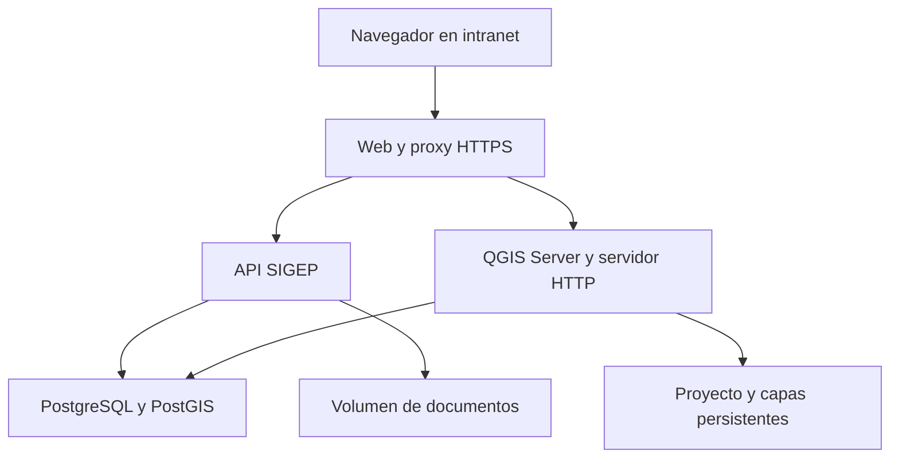

# SIGEP — Referencia de operación técnica del HomeLab

Documento conservado como referencia del despliegue de origen. Para una entrega nueva seguir el [Manual de instalación con Docker](manual-instalacion.md) y la [Preparación del paquete](preparar-entrega.md). Los nombres de contenedores, rutas y comandos de este archivo no son valores universales del destino.

Versión del documento: 0.3 · 27/11/2026.

Estado: base técnica revisada contra el código local; pendiente de ensayo de instalación en un servidor limpio. Dirigido a quien instala y mantiene el sistema, no a la persona que realiza trámites.

## 1. Alcance y evidencia

Este manual documenta el cliente web, la API, las migraciones disponibles y las dependencias cartográficas. Distingue conexión al HomeLab existente de instalación en el servidor definitivo.

Se revisó el checkout basado en `dbba868` y cambios locales aún no publicados, incluyendo vinculación de visita inicial a predio, correcciones documentales y verificador de instalación. Antes de entregar una versión, registrar el commit exacto y las modificaciones incluidas. No asumir que GitHub o el contenedor corresponden al contenido local.

Verificación actual: [Informe de pruebas del 27/11](resultado-pruebas-2026-11-27.md). Se ejecutan mediante `npm test` y `npm run build`. El Dockerfile usa Node 22. Las pruebas de API usan simulación de consultas; no certifican el esquema real ni la configuración del servidor. No se ejecutó Docker ni se accedió a PostgreSQL/QGIS desde esta revisión. Eduardo aportó evidencia del arranque y conexión básica a BD del despliegue anterior del 26/11.

El repositorio no contiene una composición completa de todos los servicios ni un esquema inicial canónico de la base territorial. Los SQL de `sql/` parten de tablas ya existentes. Una instalación totalmente nueva requiere primero completar el paquete descrito en la sección 3.

## 2. Componentes y conexiones

| Componente | Función | Ubicación/configuración |
|---|---|---|
| Cliente React/Vite | Interfaz en navegador | Código `src/`; compilado en `dist/`. |
| API Node.js | Autenticación, reglas, archivos y operaciones SQL | `api/server.mjs`, `attachments.mjs`, `permissions.mjs`, `users.mjs`, `initial-reception.mjs`. |
| Verificador técnico | Esquema, permisos y volumen privado | `api/check-installation.mjs`. |
| PostgreSQL/PostGIS | Usuarios, expedientes, datos y geometrías | Servicio externo al paquete `menu`. |
| Almacenamiento privado | Evidencias, planos y documentos | Volumen montado en `/data/private`. |
| QGIS Server | Publicación de mapas WMS | Requiere proyecto QGIS, capas y conexiones propias. |
| Servidor web/proxy | Publica interfaz y enruta API/mapa | Vite para desarrollo; servicio web dedicado para instalación definitiva. |

El navegador utiliza `/api/sigep/...`; Vite lo reescribe a `/api/...` y lo envía a `127.0.0.1:8100`. El endpoint WMS es otra conexión: hacer funcionar el túnel de la API no abre automáticamente QGIS.

Valores documentados del HomeLab, que deben comprobarse antes de reutilizarlos:

| Elemento | Referencia existente |
|---|---|
| Servidor SSH | `192.168.1.74`, usuario `eduardo`, desde red con acceso. |
| Contenedor API | `sigep-predio-api`. |
| Contenedor PostgreSQL | `sigep-postgis`. |
| Base / cuenta de aplicación | `sigep` / `sigep_editor`. |
| Cuenta administrativa de BD | `sigep_admin`. |
| Red Docker | `qgis-server_default`. |
| Puerto de API en el host | `127.0.0.1:8100`. |
| Volumen de documentos | `sigep-archivos`. |

No son nombres obligatorios para otra instalación. Registrar sus equivalentes en la ficha del servidor.

## 3. Paquete que debe entregarse

### Docker e intranet como producto

Se recomienda conservar contenedores y separar PostgreSQL/PostGIS, API, QGIS y web/proxy en servicios administrados con Compose o una herramienta institucional equivalente. Pueden convivir en un servidor. Los contenedores `sigep-postgis` y `sigep-predio-api` del inventario ya son servicios separados; no es necesario unirlos. Intranet significa acceso mediante la red privada de la institución, no un tipo especial de contenedor.

Propuesta de conexiones para la entrega:



La conexión QGIS–BD aplica a las capas PostGIS publicadas. Los fondos pueden proceder de archivos locales o servicios externos autorizados. QGIS Server puede utilizar FastCGI detrás de un servidor HTTP: el puerto y modo de proxy dependen de la imagen real; no asumir que todo contenedor QGIS acepta HTTP directamente.

Publicar sólo el acceso web necesario para las PCs. Mantener BD y API en la red de servicios y administración restringida. Usar DNS y certificado internos acordados con Informática, cuentas individuales, volúmenes persistentes y respaldos fuera del host. Un único host es una opción inicial con un punto único de fallo; si se exige alta disponibilidad hay que diseñarla y probarla aparte. Docker por sí solo no acredita seguridad, disponibilidad ni cumplimiento institucional.

Antes de cerrar la instalación, Informática debe confirmar: sistema operativo admitido, virtualización/contenedores permitidos, DNS/TLS, salida a Internet, almacenamiento, responsables de operación, retención de respaldos y objetivos de recuperación. Esto permite adaptar el paquete sin cambiar el flujo de los usuarios.

1. Código de una versión identificada, incluyendo los dos `package-lock.json` y `api/Dockerfile`.
2. Esquema inicial canónico de PostgreSQL/PostGIS y catálogos mínimos, con orden de instalación. Actualmente falta en `menu`.
3. Migraciones revisadas para esa versión y registro de las ya aplicadas.
4. Configuración reproducible de PostgreSQL, QGIS, API y servidor web: Compose o equivalente. Actualmente falta el paquete conjunto.
5. Proyecto `.qgs`/`.qgz`, recursos y referencias de capas; indicar cuáles requieren Internet y cuáles son locales.
6. Plantillas de variables sin contraseñas: `.env.example` y `api/.env.example`.
7. Manual, evidencias de aceptación, procedimiento de respaldo y restauración probado.
8. Inventario de secretos entregado por un canal privado distinto del código y del manual.

No incluir `.env.local`, contraseñas, invitaciones, archivos ciudadanos o cuentas de demostración como configuración por defecto. `sql/reset_demo_users.sql` es un reinicio de cuentas de ejemplo que desactiva otras cuentas y revoca sesiones: no forma parte de la instalación normal.

## 4. Prerrequisitos y ficha del servidor

Para desarrollo: Windows/PowerShell, Node compatible (la API declara >=22), npm, OpenSSH y acceso autorizado al HomeLab. Para backend: host Linux con Docker operativo, PostgreSQL/PostGIS y QGIS Server compatibles con la base y el proyecto existentes.

No se ha medido un mínimo de CPU/RAM para producción. Definir capacidad con cantidad de usuarios, tamaño de cartografía, documentos y pruebas de carga; evitar prometer un mínimo sin medir.

Completar antes de la instalación definitiva:

| Dato | Valor por confirmar |
|---|---|
| Sistema operativo y arquitectura | — |
| CPU, RAM, disco disponible y crecimiento | — |
| Versiones/imágenes de PostgreSQL, PostGIS y QGIS | — |
| Dominio o nombre DNS interno y certificado | — |
| Red, puertos y acceso de administración | — |
| Directorio de despliegue y usuario de servicio | — |
| Destino de respaldos y responsable | — |
| Tiempo máximo aceptable sin servicio y pérdida de datos tolerable | — |
| Acceso a Internet para capas base y descarga de dependencias | — |

Inventario de solo lectura, en Linux/HomeLab:

```bash
docker version
docker ps --format 'table {{.Names}}\t{{.Image}}\t{{.Ports}}'
docker network inspect qgis-server_default
docker inspect --format '{{json .Mounts}}' sigep-predio-api
docker inspect --format '{{json .Mounts}}' sigep-postgis
docker exec sigep-postgis psql -U sigep_admin -d sigep -c 'SELECT version(), PostGIS_Full_Version();'
```

Revisar también mounts/proyecto/imagen del contenedor QGIS identificado en el listado. No publicar salidas que contengan rutas o configuración privada sin revisarlas. Evitar imprimir todas las variables de entorno del contenedor.

## 5. Variables de configuración

### Cliente web

| Variable | Función |
|---|---|
| `VITE_DESPACHO_NOMBRE` | Nombre mostrado en la interfaz. |
| `VITE_QGIS_WMS_URL` | URL WMS alcanzable desde el navegador del usuario. |
| `VITE_QGIS_MAP` | Ruta del proyecto como la conoce QGIS Server, no ruta de la PC del usuario. |

Las variables `VITE_` se incorporan al JavaScript del navegador. Nunca poner claves administrativas ni contraseñas en ellas. Cambiarlas requiere reiniciar Vite en desarrollo o recompilar `dist/` en la entrega.

### API

| Variable | Uso |
|---|---|
| `DB_HOST`, `DB_PORT` | Servidor/servicio PostgreSQL, usualmente puerto 5432 interno. |
| `DB_NAME` | Base de datos, `sigep` en HomeLab. |
| `DB_USER`, `DB_PASSWORD` | Cuenta de aplicación y contraseña; no usar superusuario para la API. |
| `PORT` | Puerto de escucha; 8100 por defecto. |
| `SIGEP_ADMIN_KEY` | Clave de recuperación administrativa, mínimo 32 caracteres según la API. |
| `SIGEP_PRIVATE_STORAGE_DIR` | `/data/private` con almacenamiento persistente. |
| `SIGEP_SECURE_COOKIE` | `1` si el navegador accede por HTTPS; omitir o usar `0` solo en prueba HTTP local. |

El archivo `api/.env.example` enumera estas variables. El proceso Node no carga archivos `.env` por sí solo: Docker debe recibir `--env-file`, o el operador proporcionar el entorno explícitamente. Usar `SIGEP_SECURE_COOKIE=1` para acceso HTTPS; el valor 0 del ejemplo permite desarrollo HTTP local.

## 6. Ejecutar el cliente en una PC de desarrollo

En PowerShell, con el código disponible en la carpeta del proyecto:

```powershell
cd C:\Proyectos\SIGEP\menu
node --version
npm.cmd --version
npm.cmd ci
if (-not (Test-Path -LiteralPath .env.local)) {
    Copy-Item -LiteralPath .env.example -Destination .env.local
}
```

Completar `.env.local` con los valores WMS reales. No sobrescribir una configuración existente que ya funciona.

En una terminal separada, abrir el túnel a la API:

```powershell
ssh -N -o ExitOnForwardFailure=yes -L 8100:127.0.0.1:8100 eduardo@192.168.1.74
```

Mantener esa terminal abierta. Si se trabaja fuera de la LAN, usar la dirección SSH autorizada y la red/VPN disponible para el equipo.

En la terminal del proyecto:

```powershell
curl.exe -i http://127.0.0.1:8100/health
npm.cmd run dev
```

Abrir la dirección que imprima Vite. Un `/health` 200 con `status: ok` comprueba consulta básica a PostgreSQL; no verifica por sí solo todas las tablas, archivos ni mapas.

## 7. Base de datos: comprobar antes de migrar

### 7.1 Instalar PostgreSQL/PostGIS en un servidor nuevo

Hay dos entregas distintas: **traslado autorizado de la instalación existente**, usando un respaldo íntegro y archivos correspondientes, e **instalación sin expedientes previos**, usando esquema y catálogos mínimos depurados. Este repositorio aún no contiene el segundo paquete completo. No entregar una copia con datos ciudadanos o cuentas de prueba como si fuera una base vacía.

Para el traslado, obtener imagen/digest, versión mayor de PostgreSQL, versión PostGIS, extensiones, roles y ruta de datos de la instancia origen. Usar la misma combinación validada inicialmente; una actualización de versión mayor requiere otro procedimiento. Las rutas de volumen pueden cambiar entre versiones de imagen.

Ejemplo para un **host nuevo**, con nombres que no existan, tras preparar un archivo privado `~/sigep-runtime/postgres.env`:

```text
POSTGRES_DB=sigep
POSTGRES_USER=sigep_admin
POSTGRES_PASSWORD=CONTRASENA_NUEVA_GENERADA_Y_CUSTODIADA
```

Reemplazar el marcador antes de ejecutar. Son variables de inicialización para imágenes compatibles con `postgis/postgis`; no cambian automáticamente contraseñas de un volumen ya inicializado. No usar `POSTGRES_HOST_AUTH_METHOD=trust`.

En Bash/Linux, sustituir las dos variables siguientes por lo confirmado en el inventario/documentación de esa imagen:

```bash
sigep_pg_image='IMAGEN_POSTGIS_VALIDADA_CON_ETIQUETA_O_DIGEST'
sigep_pg_data_path='RUTA_DE_DATOS_DE_ESA_IMAGEN'
docker network create sigep-interna
docker volume create sigep-postgis-datos
docker run -d --name sigep-postgis --restart unless-stopped \
  --network sigep-interna \
  --env-file "$HOME/sigep-runtime/postgres.env" \
  --mount "type=volume,source=sigep-postgis-datos,target=$sigep_pg_data_path" \
  "$sigep_pg_image"
docker logs --tail 40 sigep-postgis
docker exec sigep-postgis pg_isready -U sigep_admin -d sigep
```

Comprobar cada resultado antes de continuar. No se publica 5432 hacia las PCs. La API y QGIS que necesite BD deben conectarse a `sigep-interna`; en esta instalación `DB_HOST=sigep-postgis`. Reemplazar también `qgis-server_default` por `sigep-interna` en los ejemplos posteriores. No aplicar estos comandos sobre el HomeLab existente.

Verificar PostGIS, con cuenta administradora en la base destino:

```bash
docker exec sigep-postgis psql -U sigep_admin -d sigep -v ON_ERROR_STOP=1 \
  -c 'CREATE EXTENSION IF NOT EXISTS postgis;'
docker exec sigep-postgis psql -U sigep_admin -d sigep \
  -c 'SELECT version(), PostGIS_Full_Version();'
```

PostGIS disponible no significa que existan las tablas de SIGEP. Para restaurar una instalación autorizada, preparar primero sus roles sin importar indiscriminadamente todos los privilegios del servidor origen. Para una copia con los nombres habituales se necesita al menos `sigep_editor`; revisar también propietarios de objetos y roles QGIS del respaldo. Crearlos con los privilegios aprobados y establecer contraseñas de destino mediante `\password`.

Con base destino preparada y sin tablas de negocio, guardar un respaldo propio/confiable en `~/sigep-runtime/sigep.dump` y comprobarlo:

```bash
docker exec -i sigep-postgis pg_restore --list < "$HOME/sigep-runtime/sigep.dump"
docker exec -i sigep-postgis pg_restore --exit-on-error --single-transaction \
  -U sigep_admin -d sigep < "$HOME/sigep-runtime/sigep.dump"
```

No usar `--clean` sobre la base activa. Si falla la restauración, conservar el diagnóstico y corregir la causa; no seguir con la API. Restaurar también el volumen privado correspondiente (sección 13). Revisar usuarios, sesiones, propietarios de objetos, permisos y catálogos antes de habilitar el acceso. Aplicar después únicamente migraciones posteriores a ese respaldo. La cuenta de aplicación debe conservar privilegios limitados; no resolver errores usando el administrador como `DB_USER`.

### 7.2 Comprobación del esquema y migraciones

En el servidor Linux:

```bash
docker exec sigep-postgis psql -U sigep_admin -d sigep -c "SELECT to_regclass('public.predios'), to_regclass('public.propietarios'), to_regclass('public.fundos'), to_regclass('public.organizaciones'), to_regclass('public.miembros_organizacion');"
docker exec sigep-postgis psql -U sigep_admin -d sigep -c '\d public.predios'
docker exec sigep-postgis psql -U sigep_admin -d sigep -c '\d public.expedientes'
```

`create_api_editor.sql` ya presupone `public.predios`. `enable_modulos_locales.sql` necesita otras tablas territoriales. La sola presencia de tablas no garantiza tipos/columnas compatibles.

El esquema histórico de `../archivos_sigep` y el CSV describen también estructuras con UUID diferentes del modelo BIGINT usado en la API actual. No ejecutar esos scripts como instalador general sin conciliación del esquema. Si la base está vacía, detener esta parte hasta preparar/restaurar el esquema base aprobado.

Orden por dependencias para una base territorial compatible, pendiente de prueba integral en instancia limpia:

1. `create_api_editor.sql`.
2. `add_predio_map_measurement.sql`.
3. `add_predio_geometry_history.sql`.
4. `create_expedientes.sql`.
5. `create_usuarios_locales.sql`.
6. `enable_acceso_local.sql`.
7. `create_mediciones_expediente.sql`.
8. `enable_asignacion_topografia.sql`.
9. `create_pagos_expediente.sql`.
10. `enable_pago_audit_lock.sql`.
11. `enable_dictamen_legal.sql`.
12. `enable_modulos_locales.sql`.
13. `create_archivos_expediente.sql`.
14. `enable_user_management.sql`.
15. `enable_recepcion_inicial.sql`.
16. `enable_document_integrity.sql`.

La última migración agrega y valida una relación directa entre documentos y expediente. Si existen documentos huérfanos, detiene la migración; no borra datos. Investigar esos registros antes de reintentar. La vinculación nueva de predio reutiliza `expediente_predios` y `mediciones_expediente`; no crea un segundo folio.

En una instalación existente, aplicar únicamente lo pendiente tras revisar el registro. Algunos archivos son parcialmente repetibles, pero no hay un gestor de versiones de migración. No ejecutar todos indiscriminadamente.

Ejemplo de una migración concreta, desde la raíz del código en Linux:

```bash
docker exec -i sigep-postgis psql -U sigep_admin -d sigep -v ON_ERROR_STOP=1 < sql/enable_user_management.sql
```

Detenerse si falla. `ON_ERROR_STOP` interrumpe el archivo; no revierte archivos anteriores ni sentencias ya confirmadas fuera de una transacción. Registrar archivo, versión, fecha y resultado.

Asignar la contraseña de aplicación mediante sesión interactiva, si la cuenta es nueva:

```bash
docker exec -it sigep-postgis psql -U sigep_admin -d sigep
```

Dentro de psql: `\password sigep_editor`; al terminar, `\q`. Configurar esa misma credencial en el entorno privado de la API. No cambiar la contraseña existente sin actualizar sus consumidores.

## 8. Construir e iniciar la API en un entorno preparado

Los comandos siguientes son para Linux, con red y PostgreSQL ya disponibles, y sin un contenedor llamado `sigep-predio-api`. Para reemplazar uno existente, usar la sección 12.

Desde la raíz del código:

```bash
docker build -t sigep-predio-api:VERSION_ENTREGA ./api
```

Reemplazar `VERSION_ENTREGA` por una etiqueta única y registrar el ID/digest de imagen. El Dockerfile copia los módulos de API y el verificador, instala dependencias y ejecuta como usuario `node`. Normaliza a 0644 el código copiado y comprueba su lectura/importación durante el build: un checkout creado con `umask 077` no debe dejar el código ilegible para UID 1000.

Preparar un archivo privado de entorno en una ubicación del operador (ejemplo: `~/sigep-runtime/api.env`) a partir de los nombres de la sección 5. Crear su carpeta con permisos restringidos y editar valores; no copiar secretos al manual ni a Git.

```bash
mkdir -p ~/sigep-runtime
chmod 700 ~/sigep-runtime
chmod 600 ~/sigep-runtime/api.env
docker network inspect qgis-server_default
docker volume create sigep-archivos
```

El `chmod` del archivo presupone que ya se creó con los valores correctos. Si un paso falla, resolverlo antes de iniciar. Crear un volumen con nombre existente lo reutiliza; comprobar que sea el volumen esperado. En volumen nuevo Docker inicializa el contenido y permisos desde `/data/private` de la imagen. En volumen existente o bind mount verificar escritura como usuario `node`; no dar permisos globales `777`.

```bash
docker run -d --name sigep-predio-api --restart unless-stopped \
  --network qgis-server_default \
  -p 127.0.0.1:8100:8100 \
  --env-file ~/sigep-runtime/api.env \
  --mount source=sigep-archivos,target=/data/private \
  sigep-predio-api:VERSION_ENTREGA
```

Si los servicios tienen otros nombres/red, usar los valores del inventario. No crear una red nueva vacía y asumir que PostgreSQL se conectará automáticamente.

```bash
docker logs --tail 50 sigep-predio-api
curl --fail --retry 10 --retry-all-errors --retry-delay 2 --connect-timeout 3 --max-time 10 -i http://127.0.0.1:8100/health
curl -i http://127.0.0.1:8100/api/sesion
```

Después del health check, ejecutar como el usuario configurado del contenedor:

```bash
docker exec -w /app sigep-predio-api node check-installation.mjs
```

Debe terminar con código 0 y `ok: true`. Revisa columnas del circuito principal, PostGIS, permisos básicos de lectura/inserción/actualización, secuencias, FK de documentos, presencia de administrador activo y lectura/escritura del volumen. Sólo hace consultas SQL y crea/borra un archivo temporal propio de comprobación; no inserta expedientes ni imprime contraseñas. Si falta el archivo, la imagen todavía no contiene esta versión.

En la primera instalación, si el único pendiente es la ausencia de administrador activo, crear la primera cuenta mediante la sección 11 y repetir el verificador. Resolver los demás errores antes de realizar pruebas de trámite.

El verificador no valida todas las columnas de cada catálogo, usuarios de cada área, contenido legal, QGIS, HTTPS, proxy, respaldo/restauración ni concurrencia real. Un resultado correcto habilita continuar las pruebas funcionales; no certifica el MVP completo.

Esperado: salud 200 y sesión sin autenticar 401. Con la configuración actual, probar el inicio de sesión desde la web `/api/sigep/...`: la cookie tiene ese Path y no se debe evaluar la persistencia entrando directamente a `/api/...` desde el navegador.

## 9. Comprobar QGIS y el mapa

### 9.1 Preparar las tres vistas del mapa

Aquí “vistas” se interpreta como los tres fondos que ya muestra SIGEP: **Calles, Satélite y Topográfico**. Son capas de un proyecto QGIS publicado mediante WMS; no son tres tablas ni tres vistas SQL. Si el área entrega otras tres capas temáticas, se deben inventariar y configurar además de estos fondos.

| Botón en SIGEP | Nombre WMS que solicita el código | Contenido esperado |
|---|---|---|
| Calles | `OpenStreetMap` | Mapa de calles. |
| Satélite | `Esri World Imagery` | Imágenes de referencia. |
| Topográfico | `Esri World Topo Map` | Fondo topográfico. |

Procedimiento sobre una copia del proyecto, usando QGIS Desktop compatible con el servidor:

1. Abrir el `.qgs`/`.qgz` recuperado del despliegue o crear el proyecto institucional. Agregar las tres fuentes autorizadas (XYZ/WMS, ráster o cartografía local según corresponda).
2. Comprobar que cada fuente dibuja Durango al activarla por separado. Para XYZ, usar Navegador → XYZ Tiles → Nueva conexión con la URL/licencia proporcionada por el responsable cartográfico. El nombre del botón no proporciona por sí solo una fuente de datos.
3. Revisar nombre y nombre corto de publicación de cada capa. El valor **Name** de WMS debe coincidir con la tabla. Un nombre corto configurado o publicar IDs de capas puede cambiarlo: la comprobación definitiva es GetCapabilities.
4. En Propiedades del proyecto → QGIS Server, configurar título/servicio WMS, extensión de publicación y sistemas de referencia permitidos; comprobar EPSG:3857, usado por el mapa web. Los rótulos de menú pueden variar entre versiones.
5. Guardar proyecto y archivos dependientes en una carpeta de entrega. Corregir referencias de Windows para que el servidor Linux resuelva todas las rutas. Las conexiones PostGIS usan el hostname alcanzable por QGIS, no `localhost` de la PC del diseñador.
6. Montar esa carpeta de forma persistente y legible para el usuario del contenedor, preferentemente de sólo lectura para publicar. No guardar la única copia mediante `docker cp` dentro de un contenedor desechable.
7. Usar en `VITE_QGIS_MAP` la ruta **dentro del contenedor** y publicar el endpoint HTTP WMS con el proxy institucional. Recompilar la web después de configurar la URL.

Ejemplo de correspondencia de rutas: carpeta del host `/srv/sigep/qgis` montada en `/projects`, proyecto `/projects/sigep.qgz`; la variable del cliente debe contener `/projects/sigep.qgz`. Es un ejemplo, no la ruta confirmada del HomeLab.

### 9.2 Comprobar publicación y renderizado

No hay una imagen o proyecto QGIS canónicos incluidos en `menu`; recuperar del despliegue existente su configuración, proyecto y recursos antes de instalar en otra máquina.

1. Montar proyecto y recursos en las rutas que conoce QGIS Server.
2. Verificar que las conexiones de sus capas apuntan a la base correcta, con credenciales privadas de lectura cuando corresponda.
3. Publicar una URL WMS alcanzable desde el navegador. Un hostname interno Docker no es normalmente alcanzable desde una PC.
4. Configurar `VITE_QGIS_MAP` con la ruta dentro del servicio QGIS y `VITE_QGIS_WMS_URL` con su URL accesible.
5. Verificar nombres de capas publicados: actualmente el cliente solicita `OpenStreetMap`, `Esri World Imagery` y `Esri World Topo Map`. Ajustar proyecto o cliente si no coinciden.

Comprobación desde PowerShell, sustituyendo ambos valores por los reales:

```powershell
$sigepWmsUrl = 'URL_WMS_REAL'
$sigepQgisProject = 'RUTA_PROYECTO_EN_QGIS'
curl.exe --get $sigepWmsUrl --data-urlencode 'SERVICE=WMS' --data-urlencode 'REQUEST=GetCapabilities' --data-urlencode 'VERSION=1.3.0' --data-urlencode "MAP=$sigepQgisProject"
```

Debe responder XML de capacidades con las capas esperadas. Un HTTP 200 con `ServiceExceptionReport` es un error, no una prueba aprobada. Luego probar GetMap navegando en la aplicación: que capacidades responda no certifica renderizado.

Si el WMS solo está publicado en loopback del servidor, abrir un segundo reenvío SSH con los puertos reales de QGIS o usar el proxy autorizado. El túnel 8100 de la API no lo sustituye. Un fallo de fondo WMS puede coexistir con predios consultables por API. Las capas base externas necesitan salida a Internet o una alternativa local autorizada en la intranet.

Después de obtener capacidades, comprobar las tres capas desde una segunda PC en la intranet. Ejemplo PowerShell para obtener una imagen de Calles, con las variables del ejemplo anterior:

```powershell
curl.exe --fail --get $sigepWmsUrl --data-urlencode 'SERVICE=WMS' `
  --data-urlencode 'REQUEST=GetMap' --data-urlencode 'VERSION=1.3.0' `
  --data-urlencode "MAP=$sigepQgisProject" --data-urlencode 'LAYERS=OpenStreetMap' `
  --data-urlencode 'STYLES=' --data-urlencode 'CRS=EPSG:3857' `
  --data-urlencode 'BBOX=-11655000,2740000,-11640000,2760000' `
  --data-urlencode 'WIDTH=800' --data-urlencode 'HEIGHT=600' `
  --data-urlencode 'FORMAT=image/png' --output prueba-calles.png
```

Repetir cambiando `LAYERS` por cada nombre exacto de la tabla y un archivo de salida distinto. Abrir las imágenes: un XML de excepción guardado como `.png` o una imagen vacía no aprueba la prueba. Verificar también zoom y selección de predio en la aplicación; el contorno de predios se obtiene por API y se superpone al fondo.

### 9.3 Intranet con o sin Internet

Si los fondos usan proveedores externos, QGIS necesita salida autorizada a esos servicios aunque los usuarios sólo abran una dirección interna. Si no se configura WMS y se activa el fondo alternativo actual, el navegador intenta acceder directamente a `tile.openstreetmap.org`: tampoco funciona sin Internet.

Para una intranet sin salida, entregar fuentes cartográficas locales autorizadas y publicar esas capas mediante QGIS interno. Ajustar nombres y atribuciones de `src/config/map.js` si cambian los proveedores; no atribuir cartografía institucional a Esri. Registrar cobertura, fecha, actualización y derechos de uso. No suponer que los servicios públicos permiten descarga masiva para operar desconectado.

Si el servidor no puede descargar dependencias, preparar fuera de él las imágenes aprobadas, el frontend compilado, proyecto/capas y verificaciones de integridad; transferir mediante el procedimiento de Informática y cargar las imágenes con `docker load`. Conservar digest/versiones. Las actualizaciones de esas fuentes y paquetes forman parte de la operación técnica.

## 10. Publicación en servidor definitivo

En una intranet, el objetivo es que el personal abra una URL y no tenga que ejecutar npm o mantener un túnel SSH individual. La instalación concreta del proxy, DNS y TLS depende del servidor que proporcionará la empresa.

```powershell
npm.cmd ci
npm.cmd run build
```

Publicar `dist/` con un servidor web dedicado. `vite preview` sirve para revisar el compilado localmente, no es el servidor de producción. El proxy de desarrollo en `vite.config.js` no se incluye dentro de `dist/`.

Contrato que debe implementar y probar la configuración definitiva:

| Ruta/conexión | Tratamiento |
|---|---|
| `/` y recursos estáticos | Servir `dist/`; navegación por hash actual. |
| `/api/sigep/...` | Enviar al backend como `/api/...`, conservando consulta, método, cuerpo, cookies y respuestas. |
| WMS | URL/proxy QGIS con parámetros conservados; mismo esquema HTTPS que la web cuando se publica con TLS. |
| API/BD/almacenamiento | Accesibles a los servicios necesarios, no publicar la carpeta de adjuntos como archivos estáticos. |

Permitir uploads de archivo de 10 MB más el encabezado multipart y las respuestas PDF/imagen. Configurar límite coherente del proxy, tiempo de petición y ausencia de caché para API autenticada. La API aplica el límite real del archivo.

La comprobación de mismo origen del proxy Vite no existe por sí sola en producción; conservar una política equivalente para escrituras en el proxy/backend y verificar accesos, cookies y carga de archivos. Con HTTPS habilitar `SIGEP_SECURE_COOKIE=1`. Probar autenticación real bajo el dominio final antes de aceptar la instalación.

## 11. Primera cuenta y comprobación funcional

Con migraciones aplicadas y clave de recuperación configurada:

1. Abrir la web y elegir **Administrar con clave**.
2. Introducir la clave administrativa por el canal privado, sin capturarla en la evidencia del manual.
3. Crear una cuenta individual con rol Administración, nombre, correo y contraseña de 12 a 128 caracteres.
4. Volver al inicio y entrar con esa cuenta.
5. Crear las cuentas del personal con su rol. Revisar/desactivar las cuentas de demostración antes del uso real.

La clave de recuperación no es una cuenta de trabajo. Las acciones realizadas por esa vía se identifican como recuperación en auditoría. No ejecutar el reinicio de usuarios de prueba para crear la primera cuenta de una instalación real.

Pruebas de aceptación, en base de pruebas con datos ficticios:

| Comprobación | Resultado esperado |
|---|---|
| Login/logout | Sesión válida; al salir, acceso autenticado bloqueado. |
| Mapa y búsqueda | Renderizado WMS y localización de predio por API. |
| Expediente | Folio y movimiento con actor autenticado. |
| Medición | Solicitar, asignar, registrar visita; otro topógrafo no puede escribirla. |
| Evidencia/plano | Archivo válido se guarda y se consulta según permisos. |
| Persistencia | Tras reiniciar API se conserva archivo y registro. |
| Pago | Pago y movimiento juntos; duplicado rechazado sin doble cargo. |
| Administración | Crear/editar/baja; último administrador protegido. |
| Permisos | Usuario de consulta recibe denegación en escrituras no autorizadas. |
| Restauración | Copia restaurada en entorno aislado permite consultar registros y adjuntos. |

Capturar fecha, versión, responsable, resultado y evidencia sin datos sensibles. No declarar aceptada la instalación solamente porque `/health` funciona.

## 12. Actualización y reversión

1. Registrar versión actual, imagen, red, mounts y ubicación privada de variables.
2. Hacer respaldo conjunto de BD y archivos, y conservar el frontend anterior.
3. Copiar el código de la versión nueva a una carpeta de despliegue separada.
4. Construir la imagen antes de detener la API.
5. Revisar y aplicar solo migraciones pendientes compatibles. Si falla una, detener la actualización.
6. Detener la API, renombrar el contenedor anterior con sufijo único y crear el nuevo usando el mismo volumen y entorno verificado.
7. Publicar el `dist/` de la misma versión y ejecutar salud y pruebas funcionales.

Si falla el contenedor nuevo: detenerlo, conservarlo renombrado para diagnóstico, recuperar el nombre del contenedor anterior y arrancarlo. Esto solo es una reversión válida si las migraciones son compatibles con el código anterior. Revertir también el frontend si corresponde.

Volver a una imagen anterior no deshace escrituras ni migraciones de BD. Una recuperación de datos requiere su procedimiento y evaluación de cambios posteriores al respaldo. No eliminar volúmenes para reconstruir la API.

## 13. Respaldo y restauración

Resguardar conjuntamente: base de datos, archivos privados, proyecto/capas de QGIS, configuración privada y versión de aplicación. Un contenedor renombrado es una alternativa de arranque, no un respaldo de datos.

Ejemplo en Bash/Linux para el HomeLab, durante una ventana de mantenimiento sin otros escritores. Verificar nombres antes de ejecutarlo. `pg_dump` ofrece coherencia de la BD; detener los escritores permite coordinarla con los archivos. Si hay otros clientes que escriben, también deben pausarse.

```bash
(
  set -e
  umask 077
  sigep_backup_dir="$HOME/sigep-respaldos/$(date +%Y%m%d-%H%M%S)"
  mkdir -p "$sigep_backup_dir"
  docker pull alpine:3.22
  docker stop sigep-predio-api
  trap 'docker start sigep-predio-api >/dev/null' EXIT
  docker exec sigep-postgis pg_dump -U sigep_admin -d sigep -Fc > "$sigep_backup_dir/sigep.dump"
  docker exec sigep-postgis pg_dumpall -U sigep_admin --globals-only > "$sigep_backup_dir/globales.sql"
  docker run --rm --mount source=sigep-archivos,target=/datos,readonly \
    --mount type=bind,source="$sigep_backup_dir",target=/backup \
    alpine:3.22 tar czf /backup/archivos.tar.gz -C /datos .
  sha256sum "$sigep_backup_dir/sigep.dump" "$sigep_backup_dir/globales.sql" "$sigep_backup_dir/archivos.tar.gz" > "$sigep_backup_dir/SHA256SUMS"
)
```

El ejemplo no respalda automáticamente QGIS ni secretos: añadir sus rutas reales al procedimiento. `globales.sql` puede contener hashes de credenciales y roles; custodiarlo como secreto. Definir retención y copia fuera del servidor. No usar la redirección de este ejemplo binario en PowerShell antiguo; está escrito para Bash.

Ensayo de recuperación en infraestructura aislada, nunca sobre la base activa:

1. Disponer de versiones compatibles de PostgreSQL/PostGIS, extensiones y roles requeridos. Revisar la restauración de globales antes de aplicarla; no importarlos indiscriminadamente en un servidor compartido.
2. Crear una base vacía y volumen de documentos nuevos, claramente identificados como restauración.
3. Comprobar el archivo con `pg_restore --list`; restaurar con `pg_restore --exit-on-error` en esa base.
4. Extraer `archivos.tar.gz` únicamente en el volumen nuevo y verificar permisos del usuario `node`.
5. Levantar otra API con puerto/nombre distintos y configuración que apunte a las copias.
6. Verificar login, conteos, geometrías, documentos y un expediente completo. Registrar tiempo de recuperación y resultado.

Las credenciales restauradas y sus cuentas pertenecen a la copia; no reenviar notificaciones ni conectar esa prueba a servicios de producción. No se ha realizado aún este ensayo desde este manual.

## 14. Diagnóstico

| Síntoma | Revisar |
|---|---|
| SSH no conecta | Dirección/ruta de red, servicio SSH y usuario/clave autorizados. |
| Puerto 8100 ocupado en PC | Túnel anterior u otro proceso; no abrir dos reenvíos iguales. |
| Salud 503 | Conectividad y credenciales de PostgreSQL; logs de API. |
| Salud 200, operación 503 | Migraciones, columnas y permisos específicos; salud no comprueba todo. |
| 404 al entrar o abrir función | API vieja o reescritura `/api/sigep` incorrecta. |
| Login responde bien pero vuelve a pedirlo | Path de cookie, dominio, HTTPS/Secure y proxy. |
| Lotes visibles, fondo del mapa ausente | WMS, puerto, proyecto, capas, Internet o contenido HTTP en sitio HTTPS. |
| Archivo no se carga | Estado del expediente/visita, rol/asignación, multipart, límite y permisos del volumen. |
| Archivo desaparece al recrear API | Volumen incorrecto/ausente o ruta privada distinta. |
| 401 | Sesión ausente o vencida. |
| 403 | Acción no permitida para ese rol o asignación. |
| Compila pero falla en servidor web | El proxy de Vite no se entrega dentro de `dist/`; configurar el proxy real. |

## 15. Pendientes para cerrar la versión final

- Obtener inventario de servidor definitivo y despliegue real de QGIS/PostgreSQL.
- Confirmar entrega de las tres capas base y su funcionamiento sin Internet cuando la intranet lo requiera.
- Consolidar esquema base + migraciones y comprobarlos en instancia limpia.
- Crear y validar paquete reproducible de servicios con versiones identificadas.
- Definir proxy, dominio interno, TLS y acceso a mapas desde una segunda PC.
- Ejecutar restauración completa y aceptación por rol con archivos ficticios.
- Completar capturas sin secretos y ficha de entrega firmada/aceptada por el responsable.

Las plantillas oficiales de títulos no bloquean estas tareas técnicas. Sí bloquean la validación final de generación documental, que debe describirse como pendiente.

## Referencias técnicas

- Código local: `api/Dockerfile`, `api/server.mjs`, `api/users.mjs`, `vite.config.js`, `src/config/map.js`, `src/LocalApp.jsx`, archivos SQL y documentos de despliegue.
- Vite, despliegue: https://vite.dev/guide/static-deploy.html
- Vite, variables: https://vite.dev/guide/env-and-mode
- Docker, volúmenes y respaldo: https://docs.docker.com/engine/storage/volumes/
- Docker, Compose en producción: https://docs.docker.com/compose/how-tos/production/
- Imagen PostGIS, inicialización y rutas por versión: https://github.com/postgis/docker-postgis
- PostgreSQL, pg_dump: https://www.postgresql.org/docs/current/app-pgdump.html
- PostgreSQL, pg_restore: https://www.postgresql.org/docs/current/app-pgrestore.html
- QGIS Server, WMS: https://docs.qgis.org/3.44/es/docs/server_manual/services/wms.html
- QGIS Server, preparación y publicación del proyecto: https://docs.qgis.org/3.44/en/docs/server_manual/getting_started.html

Referencias de Docker, PostGIS y QGIS verificadas/ampliadas el 27/11/2026; usar la documentación de las versiones realmente instaladas al ejecutar el procedimiento. Los ejemplos nuevos no se ejecutaron sobre el HomeLab.
